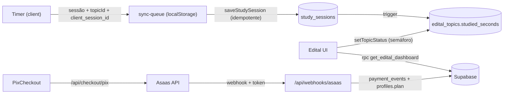

# 🧭 ROADMAP — Fluxo de Continuidade (Handoff)

> **Ponto de Restauração oficial do projeto.** Qualquer IA/sessão que assumir o projeto deve ler este arquivo **primeiro**, depois `AGENTS.md` (Next.js 16 tem breaking changes — consultar `node_modules/next/dist/docs/`).
> Atualize a seção **"Log de Execução"** ao terminar cada pacote.

- **Última atualização:** 2026-10-26 — v0 (análise estrutural concluída, nenhum código alterado ainda)
- **Passo atual:** ⏳ Aguardando "largada" do usuário + respostas das Decisões Pendentes (§6)
- **Stack:** Next.js 16.3.5 (App Router, webpack build) · React 19.2 · Tailwind 4 · Supabase (Auth + Postgres + RLS) · Asaas (pagamentos) · Gemini (`@google/generative-ai`, só p/ importar edital) · PWA (`@ducanh2912/next-pwa`)

---

## 1. Status Atual (diagnóstico de 2026-10-26)

### 1.1 O que funciona
| Área | Estado |
|---|---|
| Timer — motor | ✅ Baseado em timestamp absoluto (`lib/timer-engine/engine.ts`) + Web Worker de ticks (`workers/timer.worker.ts`). Precisão em background OK. |
| Timer — Pomodoro/Cronômetro/Histórico | ✅ Funcional, histórico local (`lib/storage/sessions.ts`), meta diária e streak (`lib/storage/goals.ts`), export PDF/Excel. |
| Sync Timer → Supabase | ⚠️ Funciona, mas "fire-and-forget" (`.catch(() => {})`) — sessões se perdem offline. |
| Edital Verticalizado | ✅ CRUD de matérias/tópicos, importação por IA (PDF/texto), busca/filtro, horas por matéria cruzando com sessões do Timer. |
| Webhook Asaas | ⚠️ Funciona no caminho feliz, mas **inseguro** (ver 1.2). |
| Auth | ✅ Supabase Google OAuth + `middleware.ts` protegendo `/dashboard` e `/vip`. |

### 1.2 Bugs / riscos identificados (priorizados)
| # | Sev. | Arquivo | Problema |
|---|---|---|---|
| B1 | 🔴 CRÍTICO | `app/api/webhooks/asaas/route.ts` | **Sem validação do header `asaas-access-token`** → qualquer pessoa pode fazer POST com `PAYMENT_RECEIVED` + e-mail e virar premium de graça. |
| B2 | 🔴 | idem | Payload do Asaas **não traz e-mail do cliente** (traz `payment.customer = "cus_..."`). Liberação depende de sorte. Precisa buscar `GET /v3/customers/{id}` ou usar `externalReference = user.id`. |
| B3 | 🟠 | idem | Respostas 400/404 fazem o Asaas **re-tentar e pausar a fila** de webhooks após falhas seguidas. Sem idempotência (evento duplicado reprocessa). Sem tratamento de `PAYMENT_REFUNDED` / `PAYMENT_CHARGEBACK_*` / `PAYMENT_OVERDUE` (nunca rebaixa plano). |
| B4 | 🟠 | `useTimerEngine.ts` `loadRuntime` | Ao recarregar/fechar a aba, timer **rodando vira pausado** → usuário "perde" o estado. Como a fonte de verdade é o timestamp, deve continuar rodando. |
| B5 | 🟠 | `PomodoroPanel.tsx` | Fila (queue), matéria, complemento, `topicId` e fase **não são persistidos** → somem no reload. Se o pomodoro terminar com a aba fechada, o modal de conclusão nunca abre (`isActive=false`) e o tempo salvo **excede a duração** (sem clamp). |
| B6 | 🟠 | `StopwatchPanel.tsx` | Matéria/complemento não persistidos. |
| B7 | 🟠 | `TimerApp.tsx` | Sync com Supabase sem fila de retentativa nem idempotência (risco de perda e de duplicata). |
| B8 | 🟠 | `app/actions.ts` `getEditalVerticalizado` / `getRadarData` | Busca **todas** as sessões do usuário e cruza em JS O(matérias × sessões) a cada render → lento em editais longos/usuários antigos. |
| B9 | 🟠 | `saveGeneratedEdital` | Até 60 INSERTs sequenciais, **sem transação** (falha no meio = edital pela metade). |
| B10 | 🟡 | `EditalVerticalizado.tsx` (33 KB, 1 componente) | `router.refresh()` após toda mutação (refaz todas as queries); sem memoização; nome do concurso só em `localStorage`; **não existe semáforo de cores** (apenas booleano `completed`); toggles rápidos têm race condition no rollback. |
| B11 | 🟡 | `PomodoroPanel.tsx` | Ao finalizar sessão com `topicId`, marca o tópico como **concluído automaticamente** (deveria registrar tempo e pedir a cor do semáforo). |
| B12 | 🟡 | `dashboard/page.tsx` vs `vip/page.tsx` | Regra de plano inconsistente (`admin` não é redirecionado ao VIP no dashboard). Checagem de plano duplicada em 4 lugares. |
| B13 | 🟡 | `middleware.ts` | Convenção **deprecada no Next 16** → renomear para `proxy.ts`. Matcher roda também em `/api/webhooks`. |
| B14 | 🟡 | `next.config.ts` | `typescript.ignoreBuildErrors: true` esconde erros de tipo. |
| B15 | 🟡 | `app/pricing/page.tsx` | `isBeta = true` hardcoded; links de pagamento fixos sem vínculo com o usuário. |
| B16 | 🟡 | `.env.example` | Ainda lista Stripe; faltam variáveis do Asaas. |
| B17 | ℹ️ | git | `git status` retornou `fatal: this operation must be run in a work tree` no sandbox (log funciona). Investigar no Passo 0. |

### 1.3 Código "zumbi" (funcionalidades fora do pivot)
| Item | Arquivos |
|---|---|
| Sala de Leitura IA + Flashcards | `components/dashboard/AIStudyRoom.tsx`, `FlashcardViewer.tsx`, `CaixaDeFlashcards.tsx`, `lib/storage/decks.ts`, `app/api/ai/study/route.ts`, `getLastStudySession` |
| Sintetizador Binaural | `components/dashboard/AmbientSounds.tsx` |
| Revisões Espaçadas (1d/7d/30d) | `components/dashboard/SpacedReviewsWidget.tsx`, `getTodayReviews`/`markReviewCompleted`/`postponeReview`, bloco em `saveStudySession`, migration `02` |
| Missões de Hoje (cronograma) | `components/dashboard/DailyMissions.tsx` |
| Utilitários soltos | `app/api/ai/models/route.ts` (debug), `upgrade_admin.js`, `db/schema.ts` (Drizzle desatualizado e **não usado**), deps `drizzle-orm`, `drizzle-kit`, `postgres` |
| Copy de marketing desatualizado | `dashboard/page.tsx`, `pricing/page.tsx`, `como-usar/page.tsx` (citam flashcards, binaural, SM-2) |
| A decidir (§6) | `RadarNegligencia.tsx`, `EditalProjection.tsx`, `ConsistencyHeatmap.tsx`, `SubjectPieChart.tsx` |

---

## 2. Arquitetura Definida (nova fase)

### 2.1 Estrutura de pastas (alvo)
```
app/
  timer/page.tsx                  # Versão Grátis (anônimo ou logado)
  dashboard/page.tsx              # Free logado: upsell + métricas básicas
  vip/page.tsx                    # Área VIP = Edital Verticalizado Inteligente
  pricing/page.tsx                # Planos + checkout Pix
  actions/                        # (antes: app/actions.ts monolítico)
    _safe.ts                      #   wrapper safeAction (auth + try/catch + Result tipado)
    sessions.ts                   #   saveStudySession (idempotente)
    edital.ts                     #   CRUD edital + semáforo + import transacional
    profile.ts                    #   getUserProfile / plano
  api/
    ai/edital/route.ts            # Import de edital via Gemini (mantido)
    checkout/pix/route.ts         # NOVO: cria cliente+cobrança Pix no Asaas
    checkout/status/route.ts      # NOVO: polling do status da cobrança
    webhooks/asaas/route.ts       # Reescrito: token + idempotência + eventos
components/
  timer/                          # PomodoroPanel, StopwatchPanel, TimerApp, SoundSelect
  edital/                         # NOVO (split do EditalVerticalizado de 33 KB)
    EditalBoard.tsx  SubjectRow.tsx  TopicRow.tsx  TrafficLight.tsx
    EditalHeader.tsx EditalImport.tsx EditalFilters.tsx
  billing/                        # PixCheckout.tsx, VerifyPaymentButton.tsx
  dashboard/                      # FocusWrapper, PremiumObserver, gráficos mantidos
lib/
  timer-engine/                   # engine.ts (puro), useTimerEngine.ts, session-context.ts (NOVO)
  storage/                        # sessions.ts, goals.ts, sync-queue.ts (NOVO: fila offline)
  asaas/                          # NOVO: client.ts (fetch tipado), types.ts, webhook.ts
  supabase/                       # client.ts, server.ts, admin.ts (NOVO: service role fail-fast)
  plans.ts                        # NOVO: isPremium(profile) — fonte única
db/migrations/
  05_pivot_edital_semaforo.sql    # NOVO (ver 2.2)
proxy.ts                          # (antes: middleware.ts)
docs/ROADMAP.md                   # ESTE ARQUIVO
```

### 2.2 Schema de banco (Supabase/Postgres) — Migration `05`
> Migrations são executadas **manualmente** pelo usuário no SQL Editor do Supabase. O código deve tolerar a ausência temporária das colunas novas até a migration rodar? **Não** — a migration é pré-requisito do Passo 5 em diante.

```sql
-- profiles (existente) + colunas
plan              text   -- 'free' | 'premium' | 'admin'   (existente)
plan_expires_at   timestamptz NULL   -- NULL = vitalício (Plano Carreira) ou free
asaas_customer_id text UNIQUE NULL

-- exam_goals (existente) + coluna
exam_name         text   -- substitui localStorage "timer_exam_name"

-- edital_subjects (existente) + colunas
position          int DEFAULT 0
-- studied_hours: DEPRECADA (não usada; horas vêm das sessões)

-- edital_topics (existente) + colunas
user_id           uuid  -- denormalizado (backfill) → RLS simples + índice
status            text NOT NULL DEFAULT 'none'
                  CHECK (status IN ('none','red','yellow','green'))   -- 🚦 SEMÁFORO
studied_seconds   int  NOT NULL DEFAULT 0      -- acumulado via trigger
last_studied_at   timestamptz NULL
position          int  DEFAULT 0
-- completed (existente) = "teoria vista" (independente do semáforo)

-- study_sessions (existente) + colunas
edital_topic_id   uuid NULL REFERENCES edital_topics(id) ON DELETE SET NULL
client_session_id uuid UNIQUE NULL   -- idempotência da fila offline

-- NOVA: payment_events (auditoria + idempotência do webhook)
id text PK (event id do Asaas) | event text | payment_id text | customer_id text
user_id uuid NULL | billing_type text | value numeric | status text
raw jsonb | processed_at timestamptz | error text NULL

-- Índices
study_sessions(user_id, finished_at DESC), study_sessions(edital_topic_id)
edital_subjects(user_id, position), edital_topics(subject_id, position), edital_topics(user_id)

-- Funções / Triggers
trg_session_topic_time   AFTER INSERT ON study_sessions → soma studied_seconds/last_studied_at no tópico
rpc save_generated_edital(jsonb)   → import transacional (1 chamada)
rpc get_edital_dashboard()         → matérias + tópicos + segundos agregados no SQL
```

**Semântica do semáforo (proposta):** ⚪ `none` não iniciado · 🔴 `red` não domino · 🟡 `yellow` preciso revisar · 🟢 `green` domino. Clique cicla as cores; salvamento otimista com debounce e rollback seguro.

### 2.3 Padrões obrigatórios
- **Server Actions** retornam `{ ok: true, data } | { ok: false, error }` via `safeAction` (auth + try/catch + log). Nunca lançar para o client.
- **Plano**: sempre usar `lib/plans.ts#isPremium` (considera `admin` e `plan_expires_at`).
- **Timer**: estado persistido em chave versionada (`timer:v2:<modo>`), nunca deduzido de contador.
- **Webhooks**: responder `200` para tudo que não for erro transitório (evita pausa da fila Asaas); erros registrados em `payment_events.error`.
- Sem `any` novo; remover `ignoreBuildErrors` ao final do Passo 2.

---

## 3. Passo a Passo da Implementação (To-Do)

> Legenda: ⬜ pendente · 🔄 em andamento · ✅ concluído. Cada passo termina com `npm run build` verde + commit `tipo(escopo): ...`.

### Passo 0 — Baseline e rede de segurança
- ⬜ Investigar B17 (git no sandbox) e garantir commits funcionando.
- ⬜ Rodar `npm run build` e `npm run lint`; registrar erros de TS hoje escondidos (B14).
- ⬜ Atualizar `.env.example` (remover Stripe, adicionar Asaas) (B16).

### Passo 1 — 🔴 Segurança do pagamento (hotfix)
- ⬜ `lib/supabase/admin.ts` (service role, fail-fast se env ausente).
- ⬜ `lib/plans.ts` e uso em `proxy`/`dashboard`/`vip`/`timer` (B12).
- ⬜ Webhook: validar `asaas-access-token` (timing-safe) (B1); resolver usuário por `externalReference` → `asaas_customer_id` → `GET /customers/{id}`.email (B2); idempotência + eventos de estorno/chargeback/atraso; política de 200 (B3). *(Tabela `payment_events` entra no Passo 4; até lá, idempotência por estado do perfil.)*

### Passo 2 — Limpeza de código zumbi
- ⬜ Remover arquivos/funções da §1.3 (após Decisão D1).
- ⬜ Remover deps não usadas (`drizzle-orm`, `drizzle-kit`, `postgres`) e `db/schema.ts`.
- ⬜ Atualizar copy (dashboard, pricing, como-usar) para o pivot.
- ⬜ `middleware.ts` → `proxy.ts` (codemod oficial) e excluir `/api/webhooks` do matcher (B13).
- ⬜ Remover `ignoreBuildErrors` e corrigir os erros de tipo (B14).

### Passo 3 — Timer blindado (Versão Grátis)
- ⬜ `loadRuntime`: manter `running` após reload (B4).
- ⬜ `lib/timer-engine/session-context.ts`: persistir preset, fila, fase, matéria, complemento, `topicId` (B5, B6).
- ⬜ Detecção de conclusão "ao voltar": se o pomodoro terminou com a aba fechada, abrir modal com tempo **clampado** à duração (B5).
- ⬜ Worker agenda alarme no instante exato do fim (não só ticks) + Notification.
- ⬜ Sincronização entre abas (evento `storage`) para não haver dois timers divergentes.
- ⬜ `lib/storage/sync-queue.ts`: fila offline com `client_session_id`, retentativa no `online`/load (B7).
- ⬜ UI/UX: anel de progresso, atalho de teclado (Espaço = iniciar/pausar), feedback de "salvo/sincronizando".

### Passo 4 — Migration 05 (schema da §2.2)
- ⬜ Escrever `db/migrations/05_pivot_edital_semaforo.sql` idempotente (IF NOT EXISTS) com backfill de `edital_topics.user_id`.
- ⬜ **Usuário executa no Supabase** e confirma. (Drop de tabelas zumbi só com consentimento — D3.)

### Passo 5 — Edital: camada de dados
- ⬜ Quebrar `app/actions.ts` em `app/actions/*` com `safeAction`.
- ⬜ `getEditalVerticalizado` → RPC `get_edital_dashboard` (B8).
- ⬜ `saveGeneratedEdital` → RPC transacional (B9).
- ⬜ Novas actions: `setTopicStatus`, `reorder`, `saveExamName` (DB).
- ⬜ `saveStudySession` aceita `editalTopicId` + `clientSessionId` (upsert idempotente).

### Passo 6 — Edital: UI e performance para editais longos
- ⬜ Split em `components/edital/*` com `React.memo` por linha.
- ⬜ `TrafficLight` (semáforo) com update otimista + debounce + rollback por versão (B10).
- ⬜ Busca com `useDeferredValue`; render de tópicos só de matérias abertas; `content-visibility: auto` nas linhas (virtualização leve).
- ⬜ Eliminar `router.refresh()` desnecessários (estado local + revalidação pontual).
- ⬜ Filtro por cor, contadores por cor, tempo estudado por tópico.

### Passo 7 — Integração Timer ↔ Edital
- ⬜ Botão ▶ do tópico abre o Timer com `topicId` persistido no contexto (Passo 3).
- ⬜ Ao concluir sessão: grava tempo no tópico (trigger) e pergunta a cor do semáforo — remove o auto-concluir (B11).

### Passo 8 — Checkout Pix via API Asaas
- ⬜ `lib/asaas/client.ts` (sandbox/prod por env, timeout, erros tipados).
- ⬜ `POST /api/checkout/pix`: cria/reaproveita cliente (CPF obrigatório p/ Pix, `externalReference = user.id`), cria cobrança `PIX`, retorna QR Code + copia-e-cola.
- ⬜ `components/billing/PixCheckout.tsx`: QR, copiar, polling de status, expiração, mensagens de erro claras (CPF inválido, Asaas fora, cobrança expirada).
- ⬜ `plan_expires_at` por plano (mensal 30d, anual 365d, carreira NULL) + `isBeta` → env `NEXT_PUBLIC_SALES_OPEN` (B15).

### Passo 9 — QA final e documentação
- ⬜ Build + lint verdes; checklist manual (timer em background, reload, offline, webhook sandbox, edital com 60 matérias × 200 tópicos).
- ⬜ Atualizar este ROADMAP e `README.md`.

---

## 4. Dependências Críticas

| Dependência | Uso | Variáveis de ambiente | Observações |
|---|---|---|---|
| **Supabase** | Auth, Postgres, RLS | `NEXT_PUBLIC_SUPABASE_URL`, `NEXT_PUBLIC_SUPABASE_ANON_KEY`, `SUPABASE_SERVICE_ROLE_KEY` | Service role **só** no servidor (`lib/supabase/admin.ts`). Migrations manuais. |
| **Asaas API v3** | Cobrança Pix, clientes | `ASAAS_API_KEY`, `ASAAS_API_URL` (`https://api-sandbox.asaas.com/v3` ou `https://api.asaas.com/v3`) | Pix exige `cpfCnpj` do cliente. |
| **Asaas Webhook** | Liberação/rebaixamento de plano | `ASAAS_WEBHOOK_TOKEN` (configurado no painel Asaas → Webhooks → "Token de autenticação") | URL: `/api/webhooks/asaas`. Eventos: `PAYMENT_CONFIRMED`, `PAYMENT_RECEIVED`, `PAYMENT_REFUNDED`, `PAYMENT_CHARGEBACK_REQUESTED`, `PAYMENT_OVERDUE`, `PAYMENT_DELETED`. |
| **Gemini** | Import de edital (PDF/texto) | (chave já usada em `app/api/ai/edital/route.ts`) | Limite por `profiles.ai_edital_count`. |
| **Web Worker + Notifications API** | Timer em background | — | Navegadores congelam abas; precisão garantida por timestamp. |

### Fluxo de dados central


---

## 5. Log de Execução
| Data | Passo | Resumo | Commit |
|---|---|---|---|
| 2026-10-26 | Análise | Diagnóstico estrutural, bugs B1–B17, roadmap v0 | — |

---

## 6. Decisões Pendentes (bloqueiam passos específicos)
| ID | Pergunta | Recomendação | Bloqueia |
|---|---|---|---|
| D1 | Remover Radar de Negligência, Projeção até a Prova, Heatmap e Gráfico de Pizza? | Remover Radar e Projeção como widgets (o semáforo + tempo por tópico os substitui); manter Heatmap e Pizza no Dashboard Free como "isca" de métricas. | Passo 2 |
| D2 | Semântica do semáforo (§2.2) está correta? | ⚪/🔴/🟡/🟢 como proposto. | Passo 4 |
| D3 | Autoriza **DROP** da tabela `spaced_reviews` e coluna `ai_flashcard_count` (perda de dados irreversível)? | Sim, após backup — ou apenas deixar órfãs. | Passo 4 |
| D4 | Checkout: manter links de pagamento Asaas ou migrar para Pix via API? | Pix via API (vínculo seguro por `user.id`, QR na própria página). | Passo 8 |
